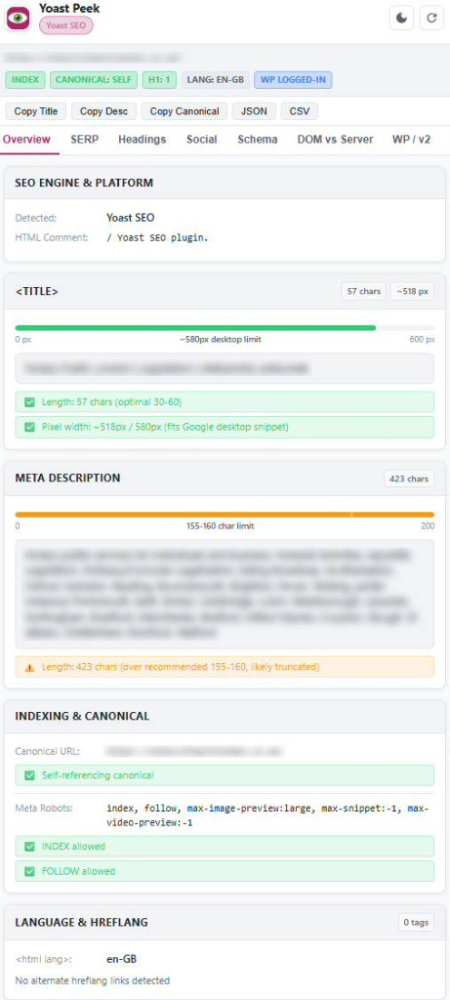

# Yoast Peek — Chrome Side Panel SEO Inspector (Manifest V3)

> **Inspect on-page SEO metadata, Schema JSON-LD graphs, heading structure, and live DOM vs. server HTML in Chrome's native side panel with one click.**
> Works 100% locally in the browser — no external servers, no tracking, works logged out.

  

---

## 🚀 Quick Install (Load Unpacked)

1. Open Google Chrome (v116+ recommended for `chrome.sidePanel` support).
2. Navigate to `chrome://extensions`.
3. In the top-right corner, toggle **Developer mode** to **ON**.
4. Click the **Load unpacked** button in the top-left toolbar.
5. Select this extension directory (the folder containing `manifest.json`).
6. The **Yoast Peek** icon will appear in your Chrome toolbar.
7. Click the toolbar icon on any page to open the side panel. (You can also pin it to your browser bar).

---

## 🎯 Key Features (V1 - No Login Required)

### 1. Automatic SEO Engine & Platform Detection
- Scans live HTML comments (`<!-- This site is optimized with the Yoast SEO plugin vX.X.X ... -->`) and `<script class="yoast-schema-graph">`.
- Reports version number (e.g. `Yoast SEO v23.0` or `Yoast SEO Premium`).
- Distinguishes other major WordPress SEO plugins:
  - **Rank Math SEO** (`<!-- Plugin: Rank Math SEO -->`, `rank-math-schema`)
  - **All in One SEO (AIOSEO)**
  - **The SEO Framework**
  - **SEOPress**
  - **WordPress (No SEO plugin detected)**
  - **Not a WordPress site** (gracefully audits any web page!)
- Automatically detects localized site paths and language subdirectories.

### 2. Live DOM Tag Analysis & SERP Pixel Meter
- **`<title>` Tag**:
  - Live character counter.
  - **Canvas-based Google Desktop Pixel-Width Estimator**: Precisely measures rendered text against the **~580px desktop threshold** using SERP font metrics (`20px Roboto, Arial`).
  - Flags truncation warnings (> 60 chars / > 580px) or short notices (< 30 chars).
- **Meta Description**:
  - Live character count and visual meter against the 155–160 character Google limit.
  - Flags empty or truncated descriptions.
- **Canonical URL & Indexing**:
  - Evaluates self-referential status vs external canonical links.
  - Direct warnings for `noindex`, `nofollow`, and `noarchive` directives (with `googlebot` specifics).
- **Hreflang & Language**:
  - Evaluates `<html lang="...">` and parses all `<link rel="alternate" hreflang="...">` tags.
  - Highlights `x-default` and identifies self-referencing language links.

### 3. Heading Outline & Structure Audit (H1–H6)
- **H1 Health Check**: Detects 0 H1s (missing) or >1 H1s (multiple).
- **Heading Outline Tree**: Interactive visual hierarchy with indented tags (`H1` to `H6`).
- **Hierarchy Jump Detection**: Alerts if levels skip (e.g., an `H1` followed directly by an `H3` without an intervening `H2`).
- Summary breakdown chips (`1 x H1`, `6 x H2`, `14 x H3`, etc.).

### 4. Interactive Google SERP Simulator
- Toggle between **Desktop** and **Mobile** snippet previews.
- Matches Google SERP formatting: favicon, domain, breadcrumb trail, clickable blue title, and snippet description with accurate truncation.

### 5. Open Graph & Twitter Social Cards
- Live card preview showing thumbnail image (`og:image`), domain, title, and description.
- Key-value breakdown of all `og:*` and `twitter:*` tags.

### 6. Yoast Schema Graph Parser (JSON-LD)
- Parses the unified Yoast `@graph` array from `<script type="application/ld+json" class="yoast-schema-graph">`.
- Breaks out entities into human-readable cards:
  - **WebPage**: `@id`, dates published & modified, language.
  - **WebSite**: Site name, publisher, URL.
  - **Organization**: Business name, logo URL, `sameAs` social profiles.
  - **BreadcrumbList**: Sequential chain (`Home › Section › Page`).
  - **Author / Person**: Name, biography, avatar.
  - **Article**: Headline, author, dates.
- Formatted raw JSON-LD viewer with one-click **Copy JSON-LD** button.

### 7. Fresh Server HTML vs. Live DOM Diff Engine
- One-click **Fetch Fresh Server**: performs a cache-busted `GET` request (`?_yoast_peek_bust=<timestamp>`).
- Inspects HTTP status code and response headers, including **`X-Robots-Tag`**.
- Compares live DOM tags against server HTML:
  - `<title>`
  - `meta description`
  - `canonical`
  - `meta robots`
  - `H1` heading text
- Flags differences if client-side JavaScript or theme scripts alter tags after initial page delivery.

### 8. One-Click Copy & Export
- **Copy Title**: Raw title string to clipboard.
- **Copy Desc**: Meta description to clipboard.
- **Copy Canonical**: Canonical URL.
- **JSON**: Complete structured audit payload as formatted JSON.
- **CSV**: Single spreadsheet row (with CSV headers) for immediate pasting into Google Sheets or Excel.

---

## 🧪 Verification & Test Guidelines

### Test 1: Multilingual / Multisite Pages
* **Target**: Any website or page with localized subdirectories or alternate `hreflang` links.
* **Verification**:
  - The side panel automatically detects and displays language sub-paths.
  - Alternates table lists all declared `hreflang` links and flags `x-default`.
  - Self-referencing canonical checks correctly resolve against the active path.

### Test 2: Yoast SEO Powered Pages
* **Target**: Any live website running the Yoast SEO plugin.
* **Verification**:
  - Plugin indicator reports Yoast SEO status and detected version number.
  - Schema tab parses and groups the `@graph` objects (WebSite, WebPage, Organization, Breadcrumbs).
  - "DOM vs Server" tab runs a fresh request to compare rendered DOM tags with raw server HTML.

### Test 3: Standard Web Pages
* **Target**: Any standard HTML web page.
* **Verification**:
  - Displays neutral indicator for pages without WordPress or Yoast.
  - Correctly extracts core SEO tags (Title, Description, Canonical, Robots, Headings outline) and generates SERP previews.

---

## 🔒 Security & Privacy (V1 & V2)

- **Zero Passwords**: The extension never prompts for, stores, or transmits passwords or credentials.
- **Ambient Browser Cookies Only**: Any WordPress REST probes rely strictly on the existing browser session in the active tab context.
- **Zero Remote Telemetry**: No third-party tracking scripts, analytics, or external CDNs. All scripts and icons are self-contained.

---

## 📂 Project Structure

1. [`PLAN.md`](PLAN.md) — Technical plan comparing logged-out vs. logged-in capabilities.
2. [`V2_FEASIBILITY.md`](V2_FEASIBILITY.md) — In-depth research notes with verified sources regarding `/wp-json/yoast/v1/get_head`, `yoast_head_json`, and post meta protection.
3. Extension Core Files:
   - [`manifest.json`](manifest.json)
   - [`background.js`](background.js)
   - [`content.js`](content.js)
   - [`sidepanel/sidepanel.html`](sidepanel/sidepanel.html)
   - [`sidepanel/sidepanel.css`](sidepanel/sidepanel.css)
   - [`sidepanel/sidepanel.js`](sidepanel/sidepanel.js)
   - [`icons/`](icons/) (16, 32, 48, 128 px)
